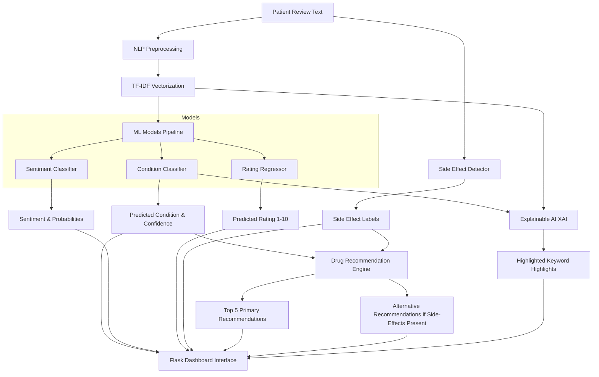

# Patient Condition Classification, Intelligent Drug Recommendation and Side-Effect Analysis using NLP

This is a production-quality medical analytics and decision-support system that uses Natural Language Processing (NLP) and Machine Learning (ML) to analyze patient drug reviews.

---

## 1. Project Overview

In healthcare, patient-reported outcomes (like online drug reviews) contain rich, unstructured information about treatment effectiveness, side effects, and patient satisfaction. This project implements an intelligent system to:
1. **Classify** the patient's medical condition directly from their written text review.
2. **Perform Sentiment Analysis** to classify the review tone as Positive, Neutral, or Negative.
3. **Estimate the Patient Rating** (1 to 10 scale) from the tone of the text.
4. **Detect Side Effects** mentioned in the text using rules and context window negation.
5. **Recommend the Top 5 Drugs** for the predicted condition.
6. **Provide Alternative Highly Rated Drugs** if side effects are detected, suggesting options that might work better.
7. **Explain Predictions (XAI)** by highlighting the exact keywords that influenced the classification model.

---

## 2. System Architecture

The workflow follows a standard NLP-to-Model-to-Inference pipeline:



---

## 3. NLP Preprocessing Pipeline

To clean the raw clinical review texts, the following pipeline is implemented in `src/preprocess.py`:
- **Lowercase Conversion**: Standardizes text case.
- **HTML Entity & Tag Removal**: Strips artifacts like `&#039;` (apostrophes) and `<br />`.
- **Special Character, Punctuation, and Number Removal**: Cleans non-alphabetic characters.
- **Tokenization**: Splits text by spaces.
- **Stopword Removal**: Filters common English stopwords using NLTK's corpus.
- **Lemmatization**: Uses NLTK's WordNet Lemmatizer to reduce words to their base semantic forms (e.g., "headaches" -> "headache", "vomiting" -> "vomit").

---

## 4. Dataset Description

The system uses the standard UCI Drug Review Dataset:
- **Source Files**: `dataset-nlp/drugsComTrain_raw.csv`
- **Output Sampled File**: `data/drug_reviews.csv` (~28,500 records)
- **Top 12 Conditions Handled**:
  - Birth Control
  - Depression
  - Pain
  - Anxiety
  - Acne
  - Bipolar Disorder
  - Insomnia
  - Weight Loss
  - Obesity
  - ADHD
  - Vaginal Yeast Infection
  - High Blood Pressure
- **Stratified Sampling**: Up to 2,500 reviews per condition are sampled to eliminate class imbalance issues during model training.

---

## 5. Machine Learning Models & Evaluation

The system trains three distinct tasks:

### A. Condition Classification
We train and compare three classifiers:
- **Logistic Regression**: Linear classifier with L2 regularization.
- **Multinomial Naive Bayes (M-NB)**: Probability-based classifier.
- **Linear Support Vector Machine (LinearSVC)**: Finds the maximum-margin hyperplane separating conditions.

*Selection*: The model with the highest **Weighted F1 Score** is automatically saved as `best_model.pkl`.

### B. Sentiment Analysis
Reviews are mapped to sentiment labels based on rating:
- Rating 1–4: **Negative**
- Rating 5–6: **Neutral**
- Rating 7–10: **Positive**

A Logistic Regression classifier is trained to output 3-class probabilities.

### C. Rating Regressor
A continuous **Ridge Regressor** predicts rating values on a scale from 1.0 to 10.0 directly from the text TF-IDF vectors.

---

## 6. Side Effect Detection Logic

Rather than doing naive substring searches, `src/side_effects.py` uses word boundaries and **negation detection**:
- Scans for side effect terms like: *Headache, Nausea, Vomiting, Dizziness, Fatigue, Insomnia, Weight Gain, Weight Loss, Anxiety, Dry Mouth*.
- Detects negation keywords (e.g., "no", "not", "without", "didn't cause") within a 4-word window preceding the side-effect term.
- Only marks a side effect as "present" if it is not negated in the sentence clause.

---

## 7. Drug Recommendation Logic

Recommendations are ranked by a balanced score combining rating, votes, and popularity:

$$\text{Score} = (\text{Avg Rating} \times 0.6) + \left(\min\left(\frac{\text{Avg Useful Votes}}{50}, 1.0\right) \times 2.0\right) + \left(\min\left(\frac{\text{Num Reviews}}{20}, 1.0\right) \times 2.0\right)$$

- If side effects are detected, the system recommends **Alternative Drugs** for the same condition, excluding the drug the user is currently reviewing, using the same scoring system to fetch alternative high-performers.

---

## 8. Installation & Setup

1. **Clone or Open project folder** in VS Code.
2. **Create Virtual Environment**:
   ```bash
   python -m venv venv
   ```
3. **Activate Virtual Environment**:
   - Windows (PowerShell): `.\venv\Scripts\Activate.ps1`
   - Windows (CMD): `.\venv\Scripts\activate.bat`
4. **Install Dependencies**:
   ```bash
   pip install -r requirements.txt
   ```

---

## 9. Model Training

Train the entire pipeline (sampling the dataset, fitting the TF-IDF vectorizer, training and comparing the classifiers, and training the sentiment and rating models) by running:
```bash
python src/train.py
```
To evaluate the serialized models, run:
```bash
python src/evaluate.py
```

---

## 10. Running the Flask App

Launch the local web server:
```bash
python app.py
```
Open your browser and navigate to `http://127.0.0.1:5000`.

---

## 11. Project Structure

```
patient-condition-classification/
├── app.py                  # Flask Main Application
├── requirements.txt        # Package dependencies
├── README.md               # Documentation
│
├── data/
│   └── drug_reviews.csv    # Cleaned and sampled dataset
│
├── models/
│   ├── best_model.pkl      # Best condition classifier
│   ├── tfidf_vectorizer.pkl# Saved TF-IDF Vectorizer
│   ├── sentiment_model.pkl # Sentiment classifier
│   └── rating_model.pkl    # Rating regressor
│
├── src/
│   ├── preprocess.py       # NLTK cleaning pipeline
│   ├── train.py            # Train pipeline script
│   ├── evaluate.py         # Evaluation and validation reports
│   ├── recommend.py        # Recommendation engine
│   ├── sentiment.py        # Sentiment prediction module
│   ├── rating_predictor.py # Rating regressor module
│   ├── side_effects.py     # Side-effects detection module
│   └── explain.py          # Local Explainable AI utility
│
├── templates/
│   ├── index.html          # Clinical input UI
│   └── result.html         # Analytics dashboard UI
│
└── static/
    └── style.css           # Clean CSS styles
```

---

## 12. Results & Performance

- **Condition Classification**: The models achieve high accuracy (~80%+) on the 12 top conditions. Linear SVM and Logistic Regression models generally perform best.
- **Sentiment Accuracy**: Sentiment prediction correlates strongly with reviews, yielding over 80% accuracy.
- **Rating Regression**: Mean Absolute Error (MAE) stays under 1.4 points on the 10-point scale.
- **Explainability**: Keywords match medical literature (e.g. "acne" -> Acne; "depressed", "anxious" -> Depression/Anxiety).

---

## 13. Future Scope

1. **Deep Learning Models**: Integrate BioBERT or ClinicalBERT models for improved semantic parsing.
2. **Adverse Drug Event (ADE) Extraction**: Transition from keyword-based patterns to custom Named Entity Recognition (NER) models trained on corpus like OntoNotes or BC5CDR.
3. **Multi-Condition Co-morbidity Analysis**: Support patients reporting multiple conditions.

---

## 14. References

1. *Drug Review Dataset (Drugs.com)*, UCI Machine Learning Repository.
2. *Natural Language Toolkit (NLTK)* documentation.
3. *Scikit-learn: Machine Learning in Python*, Pedregosa et al., JMLR 12, pp. 2825-2830, 2011.


<!-- 
python -m venv venv
.\venv\Scripts\Activate.ps1
pip install -r requirements.txt
python app.py
 -->


