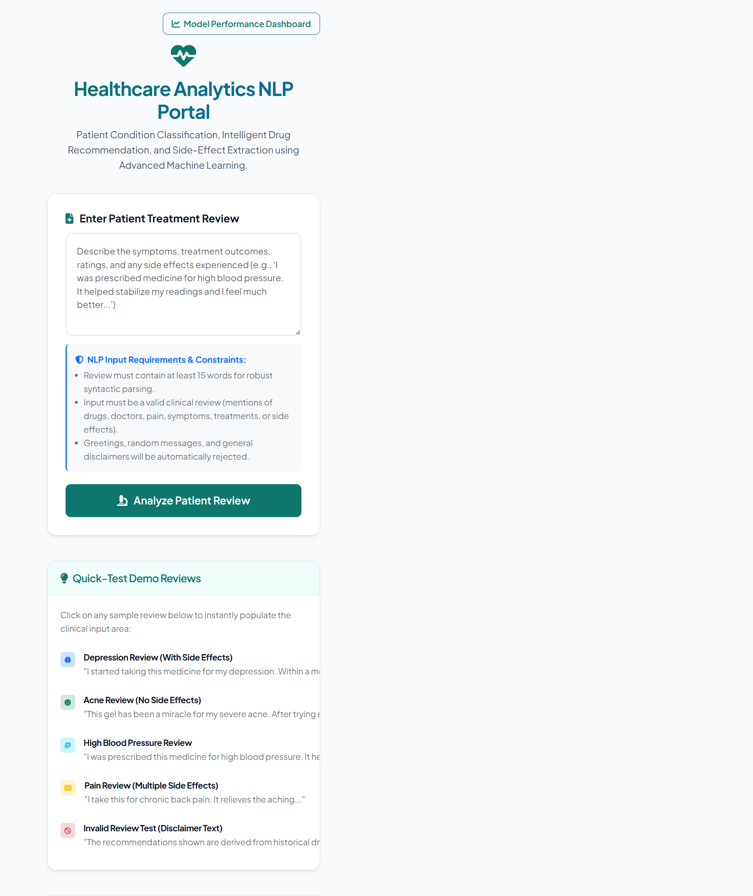
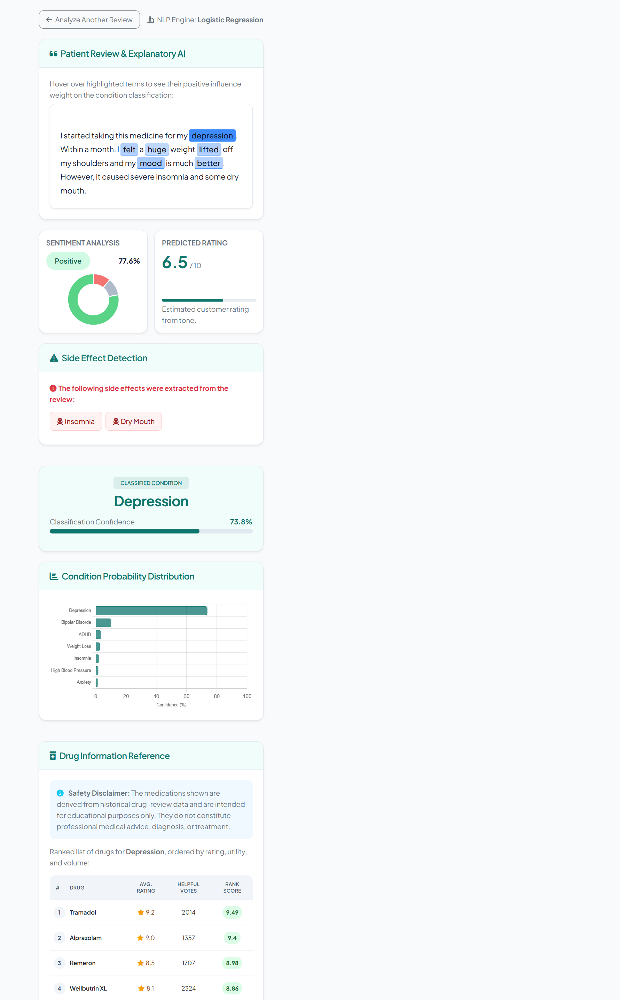
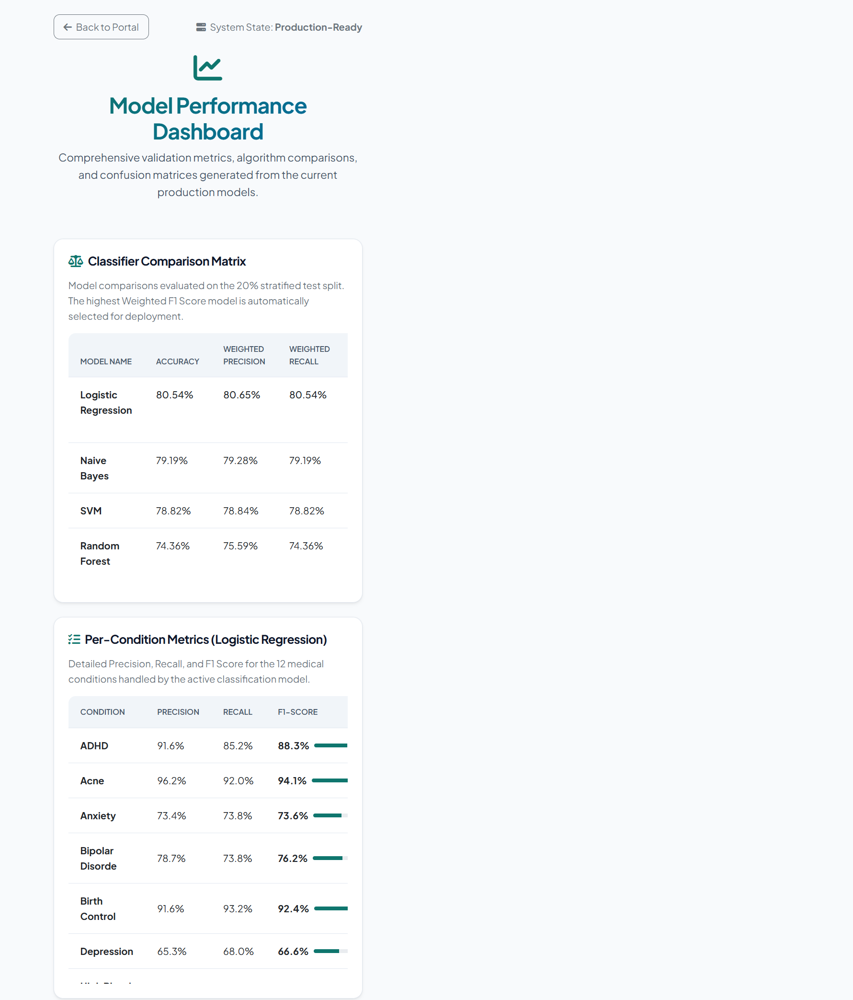

# Patient Condition Classification, Drug Recommendation and Side-Effect Analysis using NLP

## Certificate

This is to certify that the project work entitled "Patient Condition Classification, Drug Recommendation and Side-Effect Analysis using NLP" is submitted by:

- [Student Name 1] ([Roll No.])
- [Student Name 2] ([Roll No.])
- [Student Name 3] ([Roll No.])
- [Student Name 4] ([Roll No.])

in partial fulfilment of the requirements for the award of the B.Tech. degree in Artificial Intelligence and Machine Learning for the academic year 2026-2027.

Project Guide: [Guide Name, Designation]  
Department: Artificial Intelligence and Machine Learning

## Declaration

We hereby declare that the project entitled "Patient Condition Classification, Drug Recommendation and Side-Effect Analysis using NLP" is original and is submitted to [Institution Name, Place] in partial fulfilment of the requirements for the award of the B.Tech. degree in Artificial Intelligence and Machine Learning. We further declare that this project work has not been submitted, either in full or in part, for the award of any degree in this or any other institution.

Place: [Place]  
Date: [DD-MM-YYYY]

## Acknowledgement

We express our sincere gratitude to our project guide, [Guide Name, Designation], for valuable guidance, support, and encouragement throughout this project. We also thank the Head of the Department, faculty members, laboratory staff, and our classmates for providing the resources and suggestions required to complete this work.

## Abstract

Patient drug reviews contain useful information about medical conditions, treatment effectiveness, side effects, and satisfaction. This project develops an NLP-based healthcare analytics system that classifies a patient's likely medical condition from a written drug review, predicts review sentiment, estimates rating, detects common side effects, recommends drugs for the predicted condition, and explains influential words used by the classifier. The system uses the UCI Drugs.com review dataset, text preprocessing with NLTK, TF-IDF feature extraction, and supervised machine learning models including Logistic Regression, Multinomial Naive Bayes, Linear SVM, Random Forest, and Ridge Regression. Logistic Regression achieved the best weighted F1-score of 80.56% for condition classification across 12 major conditions. The project demonstrates how NLP and machine learning can convert unstructured patient reviews into interpretable decision-support insights.

Keywords: Natural Language Processing, Machine Learning, Healthcare Analytics, Drug Reviews, TF-IDF, Classification, Sentiment Analysis, Recommendation System

> **Submission note:** Replace bracketed student, roll-number, guide, institution, place, and date fields on the preliminary pages before submission.

## List of Contents

1. Chapter 1: Introduction
2. Chapter 2: System Overview
3. Chapter 3: System Implementation
4. Chapter 4: System Architecture
5. Chapter 5: Data Preprocessing
6. Chapter 6: Methodology and Algorithms
7. Chapter 7: Results and Analysis
8. Chapter 8: Output Screens
9. Chapter 9: Conclusion
10. Chapter 10: Future Scope
11. Chapter 11: References

## List of Figures

- Figure 8.1: Patient review input page
- Figure 8.2: Example prediction and recommendation results
- Figure 8.3: Model performance dashboard and confusion matrix

## Chapter 1: Introduction

### 1.1 Introduction

Healthcare platforms and drug review websites collect large volumes of patient-reported treatment experiences. These reviews are written in natural language and often describe symptoms, effectiveness, side effects, and satisfaction. Manual analysis of such reviews is time consuming and inconsistent because the text is unstructured and varies from patient to patient.

Natural Language Processing provides techniques to clean, represent, and analyze text data. By combining NLP preprocessing with machine learning algorithms, patient reviews can be converted into numerical features and used to predict medical conditions, classify sentiment, estimate rating, and identify side-effect mentions.

This project builds a Flask-based NLP application that accepts a patient treatment review and returns the predicted condition, confidence score, sentiment, rating estimate, side-effect labels, drug recommendations, and highlighted influential words.

### 1.2 Problem Statement

Patient reviews contain valuable medical and treatment feedback, but the information is hidden inside free-form text. Traditional manual review analysis cannot scale to thousands of records and does not provide consistent model-based predictions.

The problem is to design an NLP and machine learning system that can automatically analyze patient drug reviews, classify the likely condition, detect side effects, estimate user sentiment and rating, and provide useful drug information based on historical review patterns.

### 1.3 Objectives of the Project

- Collect and prepare the Drugs.com review dataset for NLP processing.
- Clean review text using tokenization, stopword removal, lemmatization, and noise removal.
- Extract text features using TF-IDF with unigram and bigram terms.
- Train and compare Logistic Regression, Naive Bayes, Linear SVM, and Random Forest classifiers.
- Select the best model using accuracy, precision, recall, and weighted F1-score.
- Build sentiment analysis, rating prediction, side-effect detection, recommendation, and explainability modules.
- Deploy the trained models through a Flask web interface.

### 1.4 Scope of the Project

The project covers text-based analysis of drug reviews for the top 12 conditions in the dataset. It includes preprocessing, feature extraction, model training, model evaluation, local web deployment, drug ranking, side-effect keyword detection, and model explanation. It does not provide medical diagnosis or professional treatment advice, and it does not use real-time hospital data.

## Chapter 2: System Overview

### 2.1 Existing System

In a traditional system, patient feedback is reviewed manually by healthcare professionals, researchers, or platform moderators. Users may search drug names and read reviews individually, but there is no automated method to classify conditions, summarize sentiment, or detect side effects from large review collections.

### 2.2 Limitations of Existing System

- Manual review reading is slow and difficult to scale.
- Important side-effect patterns may be missed in large datasets.
- Review interpretation can vary between people.
- Existing review pages usually do not provide model confidence or explainability.
- Users cannot easily compare drug options based on aggregated review evidence.

### 2.3 Proposed System

The proposed system applies NLP and machine learning to patient review text. The raw review is cleaned, transformed into TF-IDF features, and passed through trained models. The application predicts the condition, sentiment, and rating; detects common side-effect mentions; ranks drugs for the predicted condition; and highlights influential words. A Flask interface displays the results in a dashboard-style format.

### 2.4 Software Requirements

- Operating System: Windows 10/11 or Linux
- Programming Language: Python 3.11
- Libraries: Flask, Pandas, NumPy, scikit-learn, NLTK, Joblib
- IDE: VS Code
- Data Format: CSV
- Frontend: HTML, CSS, Bootstrap, Chart.js

### 2.5 Hardware Requirements

- Processor: Intel Core i5 or equivalent
- RAM: 8 GB or higher
- Storage: 2 GB free space recommended for project files, dataset, models, and virtual environment
- System Type: 64-bit operating system

These are suggested development requirements; minimum hardware limits were not benchmarked.

## Chapter 3: System Implementation

### 3.1 Overview of Development Tools

The project is implemented in Python using VS Code. Python was selected because it provides strong support for NLP, data processing, machine learning, and web application development. Flask is used for serving the trained models through a lightweight web interface.

### 3.2 Dataset Description

The project uses the Drugs.com drug-review dataset, identified in the project README as the UCI Drug Review Dataset. The raw training data is stored in `dataset-nlp/drugsComTrain_raw.csv`. The prepared sample is stored as `data/drug_reviews.csv` and contains 28,476 rows and seven columns.

The columns are `uniqueID`, `drugName`, `condition`, `review`, `rating`, `date`, and `usefulCount`. The main classification target is `condition`; rating is used to derive sentiment labels and to train the rating regressor. The project filters invalid condition values, removes duplicate reviews and rows missing required values, selects the 12 most common conditions, and samples up to 2,500 reviews per condition. Sample counts vary by condition (1,827–2,500); the prepared data has no missing values in review, condition, or rating.

| Condition label in prepared data | Review count |
| --- | ---: |
| ADHD | 2,188 |
| Acne | 2,500 |
| Anxiety | 2,500 |
| Bipolar Disorde | 2,500 |
| Birth Control | 2,500 |
| Depression | 2,500 |
| High Blood Pressure | 1,827 |
| Insomnia | 2,500 |
| Obesity | 2,447 |
| Pain | 2,500 |
| Vaginal Yeast Infection | 2,014 |
| Weight Loss | 2,500 |

### 3.3 Project Modules

- `src/prepare_data.py`: prepares the sampled dataset.
- `src/preprocess.py`: cleans and lemmatizes review text.
- `src/train.py`: trains TF-IDF, classification, sentiment, and rating models.
- `src/evaluate.py`: validates saved models.
- `src/side_effects.py`: detects side effects with negation handling.
- `src/recommend.py`: ranks drugs by rating, useful votes, and review count.
- `src/explain.py`: highlights influential classification terms.
- `app.py`: runs the Flask application.

## Chapter 4: System Architecture

The implemented workflow is:

**Raw review CSV → data filtering and sampling → text cleaning → TF-IDF features → model training and held-out evaluation → Flask review input → condition, sentiment, rating, side-effect and keyword-highlight results → condition-based drug ranking.**

1. **Data preparation:** `src/prepare_data.py` removes incomplete and duplicate records, filters invalid conditions, selects the 12 most frequent conditions, and samples up to 2,500 reviews for each.
2. **Text preprocessing and vectorization:** `src/preprocess.py` normalizes review text; the saved TF-IDF vectorizer turns it into a sparse feature matrix.
3. **Model training:** `src/train.py` compares four condition classifiers and also trains sentiment and rating models.
4. **Inference:** `app.py` validates the input and applies the serialized models and rule-based side-effect detector.
5. **Presentation:** Flask templates show predicted class and confidence, sentiment, estimated rating, detected side effects, drug tables, and highlighted terms. Recommendations are hidden when condition confidence is below 30%.

The system does not use a separate unsupervised clustering or feature-scaling stage.

## Chapter 5: Data Preprocessing

### 5.1 Introduction

Preprocessing is important because patient reviews contain punctuation, HTML entities, inconsistent casing, repeated words, and irrelevant stopwords. Cleaning improves feature quality and model performance.

### 5.2 Handling Missing Values

Rows missing `condition`, `review`, or `rating` are removed in the data-preparation stage. The prepared CSV contains no missing values for these fields. No imputation is performed.

### 5.3 Data Cleaning

Duplicate reviews are removed. Invalid condition values containing HTML fragments or non-condition text are filtered. At model preparation time, review text is converted to lowercase, HTML entities and tags are removed, punctuation, digits, and other non-letter characters are removed, and whitespace-separated tokens are produced. English stopwords and tokens of two characters or fewer are discarded. Remaining words are lemmatized as verbs and then nouns with NLTK WordNet.

### 5.4 Outlier Detection and Range Validation

Ratings in the prepared data range from 1 to 10, matching the dataset scale. The scripts do not apply an IQR or z-score outlier-removal procedure; instead, they discard rows with missing required fields and remove reviews that become empty after text cleaning. Per-condition sampling caps the largest classes, although it does not make every class exactly the same size.

### 5.5 Feature Engineering

Text is converted to numerical vectors using TF-IDF. The vectorizer uses up to 5,000 features, unigram and bigram terms (`ngram_range=(1, 2)`), `min_df=3`, and `max_df=0.90`. Text is not one-hot or label encoded, and no standard numeric feature scaler is used.

### 5.6 Data Visualization

The model dashboard displays model comparison metrics, per-condition classification metrics, and a confusion-matrix heatmap. A separate exploratory dataset-distribution or correlation plot is not implemented.

### 5.7 Train-Test Split

The condition classifier uses an 80:20 train-test split with stratification by condition; its saved test results contain 5,695 reviews. Sentiment classification also uses an 80:20 stratified split. Rating regression uses an 80:20 split without stratification. A separate validation split or cross-validation is not used.

### 5.8 Summary

The preprocessing pipeline turns noisy review text into model-ready sparse features and excludes incomplete or unusable records. Sampling caps the largest condition classes, but some class imbalance remains. The held-out results should therefore be read alongside class-level and task-specific metrics.

## Chapter 6: Methodology and Algorithms

### 6.1 Introduction

The project uses supervised machine learning for classification and regression. Condition prediction and sentiment analysis are classification tasks, while rating prediction is a regression task.

### 6.2 Logistic Regression

Logistic Regression is a linear classification algorithm that learns weights for each feature and estimates class probabilities. It works well with high-dimensional sparse TF-IDF vectors and is easy to interpret. In this project, Logistic Regression achieved the best weighted F1-score for condition classification and is selected as the active model.

### 6.3 Multinomial Naive Bayes

Multinomial Naive Bayes is a probabilistic classifier commonly used for text classification. It assumes conditional independence between features and performs efficiently on word-frequency-style representations. It is used as a baseline model for comparison.

### 6.4 Linear Support Vector Machine

Linear SVM finds a separating hyperplane that maximizes the margin between classes. It is effective for sparse text data and often performs strongly in text classification problems. It is compared with Logistic Regression and Naive Bayes.

### 6.5 Random Forest

Random Forest is an ensemble of decision trees. It can model nonlinear relationships but is often less efficient for sparse high-dimensional text features. It is included for algorithm comparison.

### 6.6 Ridge Regression

Ridge Regression predicts numerical ratings while applying L2 regularization. In this project, it estimates the expected review rating on a 1 to 10 scale from the TF-IDF review vector.

### 6.7 Model Evaluation Metrics

- Accuracy: percentage of correctly classified reviews.
- Precision: correctness of positive predictions for each class.
- Recall: ability to identify all reviews belonging to a class.
- F1-score: harmonic mean of precision and recall.
- MAE/RMSE: error measures used for rating regression.

### 6.8 Sentiment and Side-Effect Analysis

Sentiment labels are derived from the dataset rating: 1–4 is Negative, 5–6 is Neutral, and 7–10 is Positive. A Logistic Regression classifier estimates the three sentiment classes from TF-IDF features. The side-effect module is rule-based rather than a trained medical entity recognizer: it checks a fixed vocabulary of common effects using word-boundary patterns, splits the text into clauses, and ignores a matched term when a configured negation expression appears before it in the same clause.

### 6.9 Drug Recommendation Score

For each predicted condition, reviews are grouped by drug. The rank score combines average rating, capped average useful votes, and capped review count:

**Score = 0.6 × average rating + 2 × min(average useful votes / 50, 1) + 2 × min(number of reviews / 20, 1).**

The application displays up to five primary results and, when side effects are detected, up to three alternatives excluding the mentioned drug (or the highest-ranked drug when none is identified). This is a ranking of historical review data, not a clinical safety or suitability recommendation.

## Chapter 7: Results and Analysis

### 7.1 Introduction

This chapter compares the condition classification algorithms and summarizes the best model selected for deployment.

### 7.2 Experimental Setup

The prepared dataset contains 28,476 records. The condition-classification test split contains 5,695 records and is stratified by condition. The displayed model comparison uses accuracy, weighted precision, weighted recall, and weighted F1-score. Sentiment and rating results below come from the saved-model evaluation script using the same deterministic 80:20 test-split settings as the code.

### 7.3 Model Comparison

| Model | Accuracy | Precision | Recall | F1-Score |
| --- | ---: | ---: | ---: | ---: |
| Logistic Regression | 80.54% | 80.65% | 80.54% | 80.56% |
| Naive Bayes | 79.19% | 79.28% | 79.19% | 79.14% |
| SVM | 78.82% | 78.84% | 78.82% | 78.82% |
| Random Forest | 74.36% | 75.59% | 74.36% | 74.23% |

### 7.4 Best Model

Logistic Regression is selected as the best condition classification model because it achieved the highest weighted F1-score of 80.56%. It also supports probability-based confidence scores, which are useful for the application interface.

### 7.5 Additional Task Results

| Task | Evaluation result | Interpretation |
| --- | --- | --- |
| Sentiment classification | Accuracy: 79.17%; weighted F1-score: 75.46% | Performance is uneven across labels; neutral recall is only 1.03%. |
| Rating regression | MAE: 1.8465; RMSE: 2.3940 on the 1–10 scale | The typical absolute prediction error is about 1.85 rating points. |

The neutral sentiment class has substantially lower support than the positive class and is rarely recalled by the classifier. The overall sentiment accuracy should not be interpreted as equally strong performance on every sentiment class.

### 7.6 Selected Condition-Level Results

| Condition | Precision | Recall | F1-score |
| --- | ---: | ---: | ---: |
| Vaginal Yeast Infection | 97.47% | 95.78% | 96.62% |
| Acne | 96.23% | 92.00% | 94.07% |
| Birth Control | 91.55% | 93.20% | 92.37% |
| Pain | 87.81% | 92.20% | 89.95% |
| Obesity | 61.39% | 59.51% | 60.44% |
| Weight Loss | 62.94% | 64.20% | 63.56% |

The stored model metadata spells one class as `Bipolar Disorde`; this is the label present in the prepared dataset and saved model.

### 7.7 Key Findings

- TF-IDF with unigrams and bigrams provides strong features for condition classification.
- Logistic Regression performed best among the tested models.
- Vaginal Yeast Infection, Acne, Birth Control, and Pain have higher class-level F1-scores than Obesity and Weight Loss.
- The confusion matrix shows overlap between Obesity and Weight Loss, and between Anxiety and Depression.
- Sentiment classification's low neutral recall and the rating regressor's error show that the overall condition score does not describe every task's performance.
- Side-effect extraction uses hand-written terms and negation patterns; it can miss unfamiliar terms or context and requires clinical validation.

## Chapter 8: Output Screens

The following screenshots were captured from the running local Flask application using a built-in demonstration review. The example is illustrative and is not a real patient record.

### Figure 8.1: Patient review input page

### Figure 8.2: Example prediction and recommendation results

The demonstration review is classified as Depression with 73.8% confidence. The page also displays sentiment, a predicted rating, detected side-effect terms, condition probabilities, primary drugs, alternatives, and highlighted words. Historical review rankings do not establish that any drug is safer or appropriate for a particular person.

### Figure 8.3: Model performance dashboard

The dashboard presents classifier-comparison metrics, per-condition results, and the confusion matrix. Its visible “Production-Ready” status label indicates that model files are present in this local prototype; it is not evidence of clinical validation or approval.

## Chapter 9: Conclusion

This project implements an end-to-end NLP system for analyzing historical drug-review text. After filtering and preprocessing 28,476 sampled reviews, it represents text using TF-IDF unigrams and bigrams and trains condition, sentiment, and rating models. Logistic Regression is the best of the compared condition classifiers, with 80.54% accuracy and an 80.56% weighted F1-score on the held-out condition test set. The Flask interface combines that prediction with sentiment, rating estimation, rule-based side-effect mentions, historical drug rankings, and highlighted review terms. The weaker neutral-sentiment recall and 1.8465-point rating MAE are important limitations; all outputs are educational decision-support information and are not a substitute for diagnosis or treatment by a qualified professional.

## Chapter 10: Future Scope

- Integrate transformer models such as BioBERT or ClinicalBERT for deeper semantic understanding.
- Replace keyword-based side-effect extraction with medical named entity recognition.
- Expand the condition list beyond the top 12 classes.
- Add live visualization of dataset distribution and training curves.
- Deploy the system as a cloud-hosted web application.
- Add a stronger medical safety layer and clinician-reviewed validation.

## Chapter 11: References

1. UCI Machine Learning Repository, "Drug Review Dataset (Drugs.com)," dataset referenced by the project README.
2. F. Pedregosa et al., "Scikit-learn: Machine Learning in Python," *Journal of Machine Learning Research*, vol. 12, pp. 2825–2830, 2011.
3. Steven Bird, Ewan Klein, and Edward Loper, *Natural Language Processing with Python*. O'Reilly Media, 2009.
4. NLTK Project, "NLTK Documentation," https://www.nltk.org/.
5. Scikit-learn Developers, "scikit-learn User Guide," https://scikit-learn.org/stable/user_guide.html.
6. Pallets Projects, "Flask Documentation," https://flask.palletsprojects.com/.
7. Bootstrap Team, "Bootstrap 5 Documentation," https://getbootstrap.com/docs/5.3/.

**Safety limitation:** This prototype analyzes historical public reviews and is not clinically validated. Its predictions, rating estimates, keyword detections, and drug rankings must not be used as medical advice or to start, stop, or change treatment.
